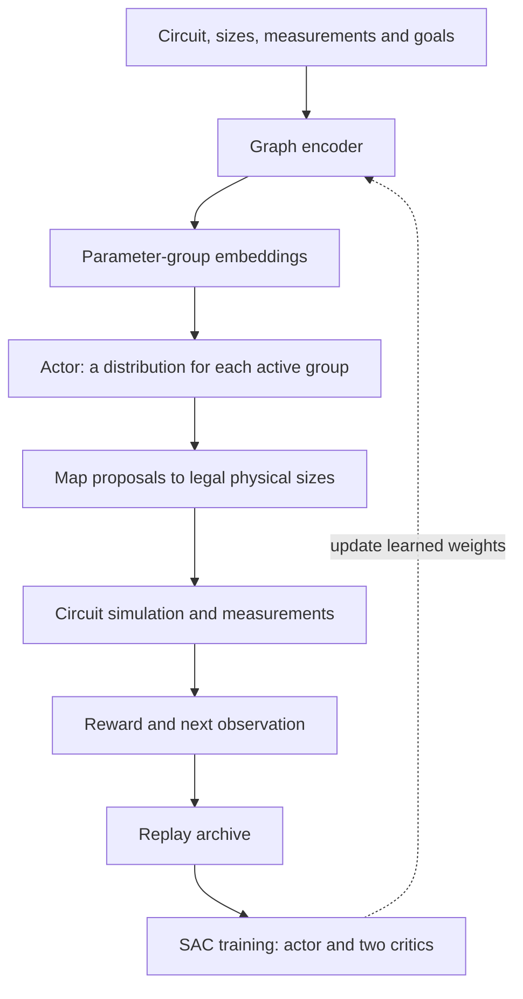
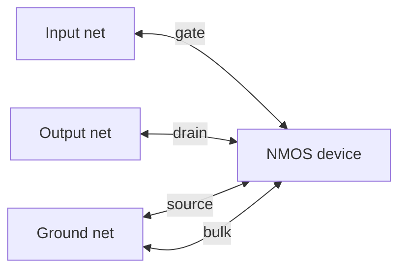
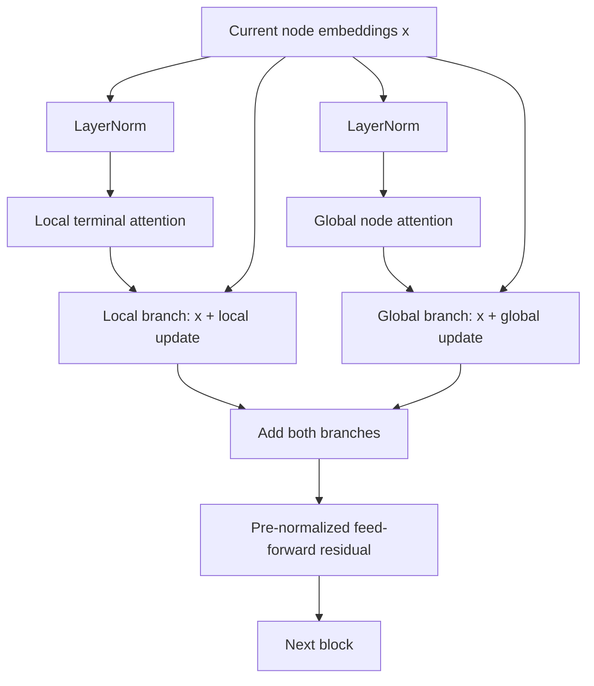
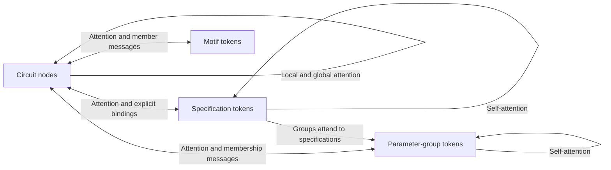
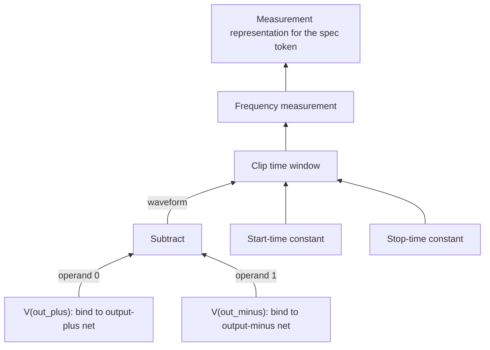

# How GraphGPS and CircuitGPS size a circuit

GraphGPS and CircuitGPS turn a circuit, its current measurements and its design goals into learned representations. The actor uses those representations to propose sizes; the critics use them to judge proposed sizes. Circuit simulation supplies the physical evidence from which these networks learn.

This guide follows GATOR's implementation from inputs to training. It assumes familiarity with transistors and specifications, but no background in transformers. Allow about 25 minutes, with extra time for the equations. Sections 1–6 explain the architecture; sections 7–9 explain stability, learning and what pretraining can establish.

**Implementation snapshot: 14 October 2026.** Here, GraphGPS means GATOR's `graph_gps`, architecture version 1. CircuitGPS means the project's `circuit_gps`, version 2, with Structured inputs. The published GraphGPS framework is identified separately. The running experiment uses hidden width 48, four heads and four blocks; these are experiment settings, not universal defaults or an established optimum.

## 1. Follow one sizing decision

Suppose an amplifier has insufficient gain while already meeting its power limit. The network receives the circuit graph, present sizes, available operating points, specification values and targets. Its job is to propose another legal set of sizes that may improve the result.



The diagram shows the actor's forward path. Each critic owns another encoder with the same architecture and separate weights. A critic additionally receives the proposed action and returns a score. During offline pretraining, the saved replay archive supplies the training examples; collecting new simulations is a separate operation.

An **embedding** is a learned vector describing something: a transistor, net, specification or parameter group. With width 48, each embedding contains 48 numbers. Individual coordinates have no assigned meaning such as “gain” or “saturation”; training chooses useful combinations. A **token** is an item represented by such a vector. It does not have to be a word.

For one circuit, the encoder returns node embeddings of shape `N × H`, group embeddings of shape `G × H`, and a context vector of width `H`. Here `N` counts devices plus nets, `G` counts parameter groups, and `H` is hidden width. The number of rows can change between circuits while the learned matrices keep the same shapes.

## 2. What the circuit graph contains

GATOR uses a **device–net bipartite graph**. Devices are one kind of node and electrical nets are another. A terminal creates a connection between its device and its net. The neural graph contains both message directions, with distinct terminal and direction labels.

For example, part of an NMOS connection looks like this:



Source and bulk remain separate terminal edges even when connected to the same net. A gate connection and a drain connection therefore carry different information. The graph is not reduced to a list of unlabeled neighbouring transistors.

Device inputs include device kind, numerical parameter features, and masks describing validity, presence and whether a parameter is optimizable. Net inputs describe roles. When enabled, operating-point features and their validity masks add measured information. Input templates may also supply PDK-relative sizes, model and testbench features. These are supplied features; attention does not infer missing measurements from nothing.

The mask distinction matters: **an unavailable drain current is different from a measured zero drain current**. Replacing both by zero without a mask would erase that distinction.

Local communication between two devices through a shared net takes two graph hops: `device → net → device`. With several local layers, information travels farther through the wiring. Global attention provides an additional route between distant nodes.

Actions correspond to **independent parameter groups**. If two transistor widths must remain equal, their common width can be one group and receive one action. A transistor whose width and length are both independent can belong to two groups. Membership ratios can express proportional sizing. Instance and net names resolve these connections but are not learned categorical identities.

## 3. How attention chooses information

Imagine updating the output-net embedding. Several connected devices can contribute messages. Attention computes how much to weight each message using the current embeddings and learned projections.

For one attention head, a receiver has a **query** `q`, each candidate sender has a **key** `k`, and each sender offers a **value** `v`. Queries and keys determine weights; values carry the information being combined. These are linear transformations of embeddings, learned during training.

The basic operation is:

\[
z_{ij}=\frac{q_i^{\mathsf T}k_j}{\sqrt{d}},\qquad
\alpha_{ij}=\frac{\exp(z_{ij})}{\sum_{t\in\mathcal A(i)}\exp(z_{it})},\qquad
m_i=\sum_{j\in\mathcal A(i)}\alpha_{ij}v_j.
\]

Here `i` receives information, `j` supplies it, `d` is the width of one head, and the allowed set `A(i)` determines who may communicate. The division by `√d` scales the dot products. Softmax produces nonnegative weights summing to one over that set. This is the scaled dot-product operation used by transformers. [Attention Is All You Need](https://arxiv.org/abs/1706.03762), [PyTorch attention definition](https://docs.pytorch.org/docs/2.14/generated/torch.nn.functional.scaled_dot_product_attention.html).

For an illustrative head, suppose the already-scaled scores are `[2, 1, 0]`. Softmax gives approximately `[0.665, 0.245, 0.090]`. If one coordinate of the corresponding values is `[4, 1, -2]`, its weighted message is about `2.726`. These are invented numbers showing the operation, not circuit measurements or inspected model weights.

In **local attention**, only physical terminal edges supply messages. GATOR uses PyG's `TransformerConv`; transformed terminal features are added to both the sender's key and its value. Thus terminal type affects both which message is selected and what it contains. Its internal root transform is disabled because GATOR supplies the residual connection outside the convolution. [TransformerConv source and equations](https://pytorch-geometric.readthedocs.io/en/latest/_modules/torch_geometric/nn/conv/transformer_conv.html).

In **global attention**, every real node in the same circuit is available, including the query node itself. An output net can therefore receive information from a distant bias device in one block. These attention connections are computational relationships; the physical netlist is unchanged.

With four heads and width 48, each head works with 12 coordinates. Heads have different learned projections and can represent different relationships, although they are not assigned specific electrical functions. Head outputs are combined into the next representation. A feed-forward network then transforms each embedding, with the same weights applied to every item of that type.

Attention weights depend on the current input. A high weight is evidence about a neural computation, not proof that changing that device causes a particular gain or power change. Simulations and controlled interventions are needed for that claim.

## 4. GraphGPS combines wiring and circuit-wide context

The published GraphGPS recipe combines structural or positional information, local message passing and global attention. GATOR adapts that recipe to terminal-aware circuit graphs. Its base Graph Transformer already performs local attention; GraphGPS adds a parallel global branch in each block and, by default, random-walk structural features. [GraphGPS paper](https://arxiv.org/abs/2205.12454).



This diagram describes the **current GATOR implementation**, including its two copies of the residual. Section 7 explains that detail.

For the Transferable spec-set input used in the comparison, GraphGPS first embeds each active specification. A run-context query attends to that set, and an MLP combines the run vector, attention result and mean spec embedding into one context vector. That context is added to circuit nodes before the graph blocks. GraphGPS is therefore goal-conditioned, but it does not keep an independent specification token interacting with nodes throughout every block. Legacy fixed-slot spec inputs use another context reader.

After the graph blocks, GraphGPS normalizes node embeddings. For each parameter group, it pools embeddings from the group's member devices, incorporating the member's parameter kind and binding ratio. A group readout combines that information with group features and context. The actor head can then produce an action for that group.

### Random-walk structural encoding

Two devices can have similar numerical features while occupying different graph positions. GATOR supplies each node with four random-walk return probabilities:

\[
\operatorname{RWSE}(i)=
\big[(P^2)_{ii},(P^4)_{ii},(P^8)_{ii},(P^{16})_{ii}\big].
\]

`P` describes a walk that uniformly chooses an outgoing terminal edge. `(P⁴)ii` is the probability of returning to node `i` after four steps. Even lengths suit a bipartite graph: one step changes node type, and an even number permits a return. Parallel terminals count separately in these walks.

A learned linear projection turns these four numbers into a width-48 contribution to the initial node embedding. They describe graph structure, not an arbitrary device number. They can distinguish some structural positions but do not uniquely identify every possible circuit.

The raw walk features depend on topology and can be cached. Their learned projection must still run with the current model weights. See [the structural-input implementation](../src/analog_optimizer/models/global_attention.py#L76).

GATOR's global branch uses full attention with quadratic pair count in the number of nodes. The GraphGPS framework's support for scalable attention alternatives does not make this particular implementation linear-cost.

## 5. CircuitGPS keeps more of the sizing problem explicit

CircuitGPS is the architecture implemented in this project. The name identifies this implementation; it does not establish a separately published method or a demonstrated performance advantage.

It maintains four families of embeddings through each joint block, plus a run-context vector:

| Token family | What it represents | Information available to the network |
| --- | --- | --- |
| Circuit nodes | Devices and nets | Wiring, terminal roles, sizes, roles and enabled physical features |
| Specifications | One token per active requirement | Values, targets, margins, units, weights, validity and measurement programs |
| Parameter groups | Independent or tied sizing variables | Parameter kind, current value, bounds, legal-domain position, grid and device membership |
| Motifs or blocks | Small circuit groupings | Member devices and a supplied or conservatively inferred block kind |

The run vector carries observation-level information such as simulation status and remaining steps. It also supplies a fallback key to relevant attention operations when an optional token set is empty.

The main exchanges are:



This is a map of information flow; operations execute in a defined order. A block first updates nodes through local and global attention. It then reads measurement trees using those node embeddings and sends specification messages back to their explicitly bound nodes. Motifs exchange information with nodes. Group membership messages are refreshed, specifications attend to nodes and each other, nodes attend to specifications, and groups attend to nodes, specifications and other groups. Nodes finally read the updated groups.

For an amplifier, a gain-spec token can therefore acquire information about the particular output and reference nodes used to measure gain. A width-group token can combine this requirement with the states of its member transistors and the rest of the circuit. This is an architectural opportunity; training must establish whether it improves sizing.

CircuitGPS also adds learned biases to global attention scores:

\[
z_{ij}=\frac{q_i^{\mathsf T}k_j}{\sqrt d}
+b_{\mathrm{distance}(i,j)}+b_{\mathrm{terminal}(j\rightarrow i)}.
\]

Distances are undirected device–net graph hops, with reachable distances clipped at eight and a separate bucket for disconnected nodes. Direct terminal edges contribute role-and-direction biases; parallel terminal contributions are summed. Distant nodes remain available to attention. A bias changes their scores rather than imposing a hard distance cutoff.

Structured inputs can add masked operating-point ratios such as `gm/Id`, `gm/gds`, overdrive and saturation headroom. Motif detection covers conservative patterns such as shared-source pairs, diode-connected mirror motifs and parameter ties. A shared-source pair is not automatically certified as a differential amplifier. Known gain-stage, bias or compensation memberships can be supplied explicitly.

At the end, the encoder normalizes nodes and groups. Its circuit context combines attention pooling, separate sums over the four token families and their counts. The shared actor and critic heads receive the same `(nodes, groups, context)` interface as GraphGPS.

All these operations respect circuit boundaries. A training batch may contain many circuits, but no node attends to a different circuit. Padding is masked. CircuitGPS uses separate attention modules for different relations; it is not one undifferentiated attention operation over every token.

## 6. The measurement-expression tree lives inside CircuitGPS

A specification has both a numerical target and a definition of what is being measured. For example, an oscillator-frequency requirement may use a differential output waveform, discard its initial transient and estimate frequency over the remaining window.

The following is a teaching expression, not literal saved OCEAN syntax:

```text
frequency(clip(V(out_plus) - V(out_minus), t_start, t_stop))
```

Its main structure is:



The parser retains supported operators, constants, operand order, analysis information and bindings. A voltage reference can bind separately to a reference or canonical ground net. An unsupported expression is represented explicitly as unknown; its meaning is not guessed from a metric's name.

There are now **two different structures**. The electrical graph describes what is wired together. The expression tree describes how a measurement is defined. Binding edges connect expression items to the electrical nodes they reference.

Inside each CircuitGPS joint block, `ProgramReader` builds learned vectors bottom-up through this tree. In compact notation, version 2 computes a base representation for expression node `p`:

\[
b_p=\operatorname{LN}_0\left(
e_{\mathrm{operator}(p)}+f_{\mathrm{numeric}}(c_p)
+\sum_{i\in\mathrm{bindings}(p)}f_{\mathrm{bind}}([h_i,e_{\mathrm{role}}])
\right).
\]

`hᵢ` is a current electrical-node embedding. `cₚ` contains numerical and validity descriptors. Square brackets denote concatenation, `e` denotes an embedding, and each `f` is a small learned network. `LN₀` is LayerNorm without learned affine parameters.

A leaf starts with `sₚ = bₚ`. A parent then combines its base with messages from its children:

\[
s_p=\operatorname{LN}_0\left(
f_{\mathrm{combine}}\left([
b_p,\sum_{c\in\mathrm{children}(p)}
f_{\mathrm{child}}([s_c,e_{\mathrm{slot}(c)}])
]\right)\right).
\]

Children are processed before parents. Slot features tell the network which operand a child occupies, allowing it to distinguish `a − b` from `b − a`. They are produced from the slot index by an MLP; the notation `e_slot` abbreviates that output. Unordered excitation-source sets deliberately do not acquire an ordering from their names. A final learned LayerNorm processes each root before its representation contributes to the corresponding spec token.

**The tree reader learns a representation of the expression.** It does not numerically execute `frequency`, solve transistor equations or replace the measurement evaluator. The simulator and evaluator produce the actual measured frequency. A learned embedding describes that measurement's structure and its relationship to the present circuit.

The complete tree is read again in each joint block using that block's current node embeddings. Four graph blocks therefore do not limit an expression to four operators. Tree height is a separate computational depth. Supported programs are bounded by a depth limit of 64 and a total of 4,096 program nodes per observation. See [ProgramReader](../src/analog_optimizer/models/circuit_gps.py#L134) and [program preparation](../src/analog_optimizer/models/measurement_program.py#L81).

## 7. Residuals and normalization explain the recent issues

A **residual connection** preserves a representation while adding a learned change:

\[
x_{\mathrm{next}}=x+F(x).
\]

The update can refine existing information rather than reconstructing it from scratch. **Pre-normalization** means applying normalization to the input of the learned update: `x + F(LN(x))`.

For a width-`H` vector, LayerNorm computes its mean and variance across its `H` features:

\[
\operatorname{LN}(x)=a\odot\frac{x-\bar x}{\sqrt{\operatorname{Var}(x)+\epsilon}}+b.
\]

`a` and `b` are learned scale and offset when affine parameters are enabled. In CircuitGPS v2's intermediate tree normalization, they are absent. This normalization concerns hidden vectors; reward scaling and physical-input scaling are separate operations. [PyTorch LayerNorm definition](https://docs.pytorch.org/docs/2.14/generated/torch.nn.LayerNorm.html).

### GraphGPS and the two residual branches

GATOR's current `PortGPSBlock` computes:

\[
\begin{aligned}
u_{\mathrm{local}}&=x+L(\operatorname{LN}_L(x)),\\
u_{\mathrm{global}}&=x+A(\operatorname{LN}_A(x)),\\
y&=u_{\mathrm{local}}+u_{\mathrm{global}},\\
x_{\mathrm{next}}&=y+\operatorname{FF}(\operatorname{LN}_{\mathrm{FF}}(y)).
\end{aligned}
\]

The merge therefore contains `2x + local update + global update`. If every learned update were zero, four blocks would produce `16x` before the encoder's final LayerNorm. This is an illustrative limiting case, not a claim that trained embeddings increase by exactly sixteen.

The published implementation also has a residual in each branch, but **normalizes each branch after its residual addition before summing the branches**. It also normalizes after the feed-forward residual; its default uses BatchNorm. GATOR's pre-normalized variant leaves two unnormalized identity paths at the merge. Thus counting two residuals alone does not establish a mistake; normalization placement changes the computation. [Original GraphGPS layer](https://github.com/rampasek/GraphGPS/blob/main/graphgps/layer/gps_layer.py).

This amplification deserves evaluation, but it is not the expression-tree failure. GraphGPS has no `ProgramReader`. The recorded check of its saved 20,000-update model found finite actor and critic outputs and no overflowing LayerNorm variances on the eight audited designs. That is limited numerical evidence, not an exhaustive guarantee. A single-residual pre-normalized GraphGPS block was discussed as an alternative; it is **not the current implementation**. See [PortGPSBlock](../src/analog_optimizer/models/encoders.py#L147) and [the numerical audit record](workbench-log/7.336-and-later.md).

CircuitGPS already combines the local and global updates with one residual:

\[
x_{\mathrm{next}}=x+\sigma(g_L)\odot L(\operatorname{LN}_L(x))
+\sigma(g_A)\odot A(\operatorname{LN}_A(x)).
\]

The gates are learned per channel. Their initial raw value is `−1`, giving `sigmoid(−1) ≈ 0.269`. Other attention relations have their own gated residuals. Gating controls an update's multiplier; it cannot guarantee that every internal operation stays finite.

### CircuitGPS and amplification inside a tree

Version 1 normalized only the final root. Repeated learned child and parent transformations could amplify intermediate tree states before reaching that root. A simplified chain with gain three per level would amplify a component by `3²⁰ ≈ 3.49 billion` over twenty levels. This illustrates repeated gain; it is not a fitted gain estimate for the failed model.

The tree itself was not growing during training. Its structure came from the fixed measurement expression. The learned **activation magnitudes** grew as weights changed. More complicated expressions provide more opportunities for amplification within one outer graph block.

In the recorded failure, a root LayerNorm input reached about `7.123 × 10²⁰`, with variance about `1.325 × 10⁴¹`, exceeding float32's maximum finite value of about `3.4 × 10³⁸`. Finite input coordinates can therefore lead to overflowing intermediate statistics. Root-only normalization came too late; an earlier checkpoint could also return finite outputs despite overflowing variance. [Failure diagnosis and version 2 repair, record 7.341](workbench-log/7.336-and-later.md).

Version 2 normalizes each base state and each newly combined parent before another tree level consumes it. The learned root normalization remains. This preserves the operators, bindings, operand order and full traversal while addressing the observed accumulation between levels. Actor, critics and target critics use the same selected architecture version, with their own weights.

Gradient clipping occurs after the forward pass and backward computation, so it cannot repair a forward pass that already produced NaNs. Likewise, clamping the actor's log standard deviation cannot make a NaN mean valid. Moving the same computation to a GPU may change speed and numerical details, but it does not by itself resolve the repeated amplification.

## 8. From group embeddings to SAC training

For each active parameter group, the shared actor head predicts a mean `μ` and a log standard deviation. Sampling uses:

\[
\varepsilon_g\sim\mathcal N(0,1),\qquad
u_g=\mu_g+\exp(\log\sigma_g)\varepsilon_g,\qquad
a_g=\tanh(u_g).
\]

The result is a normalized proposal between `−1` and `+1`. Deterministic evaluation uses `tanh(μ)`. The code clamps log standard deviation to configured limits and includes the tanh transformation in the action log probability. Its circuit-level log probability sums the per-group terms. See [GroupActor](../src/analog_optimizer/models/graph_transformer.py#L23).

The legalizer maps each proposal to an **absolute value** in that group's bounds, then projects it onto its legal grid. For linear bounds of 1–9 µm, proposal zero maps to 5 µm. For logarithmic bounds of 1–16 µm, zero maps to the geometric midpoint, 4 µm. These examples precede any grid projection. Membership rules distribute the legalized value to the bound devices. See [ActionMapper](../src/analog_optimizer/parameters/actions.py#L20).

Each critic receives the observation and the normalized proposals. It injects action information into group embeddings and bound device embeddings **before** graph processing, allowing its message passing to depend on the proposed sizing. Its final head combines pooled node embeddings, pooled active-group embeddings and circuit context into one scalar `Q(s,a)`.

There are two independently learned critics, `Q1` and `Q2`, as well as slowly updated target copies. The actor also has its own encoder. Sharing an architecture means using the same construction, not sharing weights among these networks.

The implemented SAC update fits each critic to a target of the form:

\[
y=r+\gamma\,b\left[\min(Q'_1(s',a'),Q'_2(s',a'))
-\alpha\log\pi(a'\mid s')\right],
\]

where `r` is observed reward, `γ` is the discount, `b` indicates whether bootstrapping is allowed, and primes mark target critics. The actor minimizes:

\[
\mathcal L_{\mathrm{actor}}=
\mathbb E\left[\alpha\log\pi(a\mid s)-\min(Q_1(s,a),Q_2(s,a))\right].
\]

This encourages actions the critics value while retaining an entropy term controlled by temperature `α`. GATOR also learns the temperature. Actor gradients pass through the critics' dependence on the proposed actions; they do not pass through Spectre. The simulator supplies observed outcomes for learning. These equations describe [GATOR's SAC update](../src/analog_optimizer/training/sac.py#L154); the broader maximum-entropy actor-critic approach is introduced in [Soft Actor-Critic](https://arxiv.org/abs/1801.01290).

**The current archive-training request sets `γ = 0`.** Its critic target therefore simplifies to `y = r`, without a future-value term. In this setting, held-out critic error primarily measures immediate-reward prediction on stored transitions. It does not establish multi-step planning quality or the quality of new physical designs. The setting is recorded in [the fresh CircuitGPS request](../artifacts/local/reviews/round3-all-circuits-2026-10-13/circuitgps-v2-fresh/training-circuit_gps/request.json#L1555).

## 9. What pretraining teaches, and how to test it

The architecture provides structured inputs and routes for information exchange. Training adjusts the projections, attention parameters, embeddings, feed-forward networks and action/value heads so they become useful for the reward objective.

Saved simulation data can teach associations among topology, physical state, goals, proposed sizes and measured outcomes. Offline SAC training uses rewards and critic estimates; it does not simply copy the archived actions as a supervised imitation target. This also creates a limitation: an actor can prefer actions that exploit critic errors outside the archived action distribution. A lower offline loss needs follow-up physical evaluation.

The training modes answer different questions:

| Mode | What happens to weights | What it tests |
| --- | --- | --- |
| Scratch | Start with newly initialized weights and learn on the target task | Ability to learn from the target simulation budget |
| Offline pretraining | Learn from an existing archive before target deployment | Ability to extract useful information from saved data |
| Frozen evaluation | Load pretrained weights without updating them | Direct use of the learned policy on the target |
| Fine-tuning | Load pretrained weights and update them using target data | Whether pretraining helps adaptation under a stated budget |

Pretraining on one circuit can be useful for new targets or conditions on that circuit. It can also overfit that circuit's sizes, goals or data distribution. Training on several circuits broadens the experience but does not automatically demonstrate transfer to unseen topologies.

An episode split within the same circuit tests something different from withholding an entire topology. If all usable circuits enter pretraining, an unseen-topology claim needs additional circuits excluded from that pool, or a new training split that leaves selected circuits out. Name changes alone do not create an unseen topology. The journal comparison should state which tasks, topologies and PDKs were held out and compare matched seeds and simulation budgets. The planned evidence gates are in [the experiment plan](plan-transfer-experiment.md).

Also distinguish the quantities in a training report:

| Term | Meaning |
| --- | --- |
| Transition | One saved `(state, action, reward, next state)` example, with outcome metadata |
| Learner update | One training iteration using a sampled minibatch |
| Simulation evaluation | One physical design evaluation; it need not occur during offline training |
| Checkpoint | A saved model/training state at a particular point |

Thus an archive with 187,407 transitions and a budget of 20,000 learner updates describes two different counts. Sampling can reuse transitions; 20,000 updates does not mean 20,000 distinct circuit simulations or one complete pass through the archive.

## 10. Compare the architectures and read the code

| Feature | GATOR Graph Transformer | GATOR GraphGPS v1 | GATOR CircuitGPS v2 with Structured inputs |
| --- | --- | --- | --- |
| Local terminal-aware attention | Yes | Yes | Yes |
| Global node attention in each block | No | Yes | Yes, with graph-distance and direct-terminal biases |
| Random-walk structural input | No | Default on | Default on |
| Goal information | Context injected into nodes | Context injected into nodes | Persistent spec tokens exchange information with nodes and groups |
| Group representations | Final member-based readout | Final member-based readout | Refreshed and updated throughout the joint blocks |
| Ordered measurement-tree reader | No | No | Yes, with normalization at every tree level |
| Explicit motif tokens | No | No | Yes, when available |
| Actor and critic interfaces | Shared group actor and graph critic design | Same interface | Same interface |

GATOR also contains **RGCN**, the existing relation-aware graph-convolution baseline requested for the experiments. It applies relation-specific message transforms for terminal type and direction, without attention-based neighbour selection. It is different from a plain untyped GCN. Comparing it with the transformers helps test whether learned attention is useful under the chosen circuit, data and budget conditions.

Equal hidden width and block count do not imply equal parameter count, compute or memory. CircuitGPS has more relation modules and its tree reader adds work within each block. Performance comparisons should report both simulation efficiency and learning cost; architectural richness alone does not determine the winner.

Read the implementation in this order:

1. [Shared actor and critic heads](../src/analog_optimizer/models/graph_transformer.py#L23): start with what the encoder must return and how a group becomes an action.
2. [Local blocks and GraphGPS](../src/analog_optimizer/models/encoders.py#L101): compare `PortAttentionBlock` with `PortGPSBlock`, then follow `CircuitEncoder.forward`.
3. [Global attention and RWSE](../src/analog_optimizer/models/global_attention.py#L15): inspect circuit packing, padding masks and structural features.
4. [CircuitGPS joint blocks](../src/analog_optimizer/models/circuit_gps.py#L183): trace the separate node, spec, group and motif updates, then the encoder's readout.
5. [ProgramReader](../src/analog_optimizer/models/circuit_gps.py#L134), [raw program tensors](../src/analog_optimizer/models/measurement_program.py#L81), and [expression parsing](../src/gator_workbench/spec_programs.py#L29): connect measurement syntax to bindings and bottom-up learned states.
6. [SAC training](../src/analog_optimizer/training/sac.py#L154): follow critic targets, actor gradients, temperature and target-network updates.

For papers, first read [Attention Is All You Need](https://arxiv.org/abs/1706.03762) for queries, keys, values and multiple heads; then [GraphGPS](https://arxiv.org/abs/2205.12454) for the local/global/structural combination; then [Soft Actor-Critic](https://arxiv.org/abs/1801.01290) for the learning objective. The project-specific architecture and version history are documented in [GraphGPS integration](global-encoders.md) and [CircuitGPS](circuit-gps.md).

### Check your understanding

**Why preserve gate and drain labels?** Their connections have different electrical meaning. The local network receives their distinct terminal features.

**Does global attention add wires to the circuit?** It adds information exchange inside the neural encoder. The physical circuit remains the same.

**Why can four blocks still contain a deep computation?** Each CircuitGPS block reads the entire measurement tree, whose depth is independent of block count.

**Why was a final normalization insufficient?** Intermediate tree states could grow enough to overflow before or during that final operation. Version 2 normalizes states before their reuse at the next height.

**Does a valid pretrained model establish useful transfer?** It establishes that the model can execute under its checked input contract. Transfer requires measured target-task performance against suitable baselines and a stated data split.
