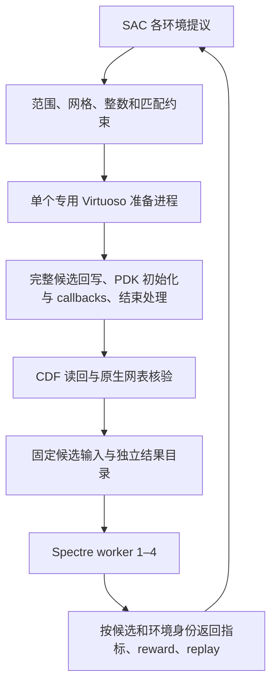

# 逐候选 CDF、原生网表与并行 Spectre SAC

2026-09-19 按用户修订撤销有限 CDF 表方案。训练与迁移入口不再读取 `table.json`，建表程序、查表后端和 Python 器件网表模板已移除。历史表及历史验收记录仅作为旧实验证据，不参与当前执行。

## 执行流程



`NativeEnvironmentFactory` 为整个采样运行启动一个准备服务。服务在独立进程的同一线程持有 `VirtuosoBridgeBackend`，取得现有 session 锁；各环境通过本机 IPC 提交完整候选。回写、回读和导出作为一个事务串行处理，不允许不同环境交错修改原理图。

专用设计是 `--creation-receipt` 标识的、项目已创建并核验的 OTA 测试电路（含 core 和 testbench），不是任意用户原设计。应使用专用 Virtuoso 会话，所有本项目使用者共享 `--state-root`，运行期间不得手动编辑或打开冲突的 ADE/Maestro 窗口。适配器不会自动复制任意生产电路。

候选 A 导出完成即交还其环境执行 standalone Spectre，准备进程随即处理 B。每个候选保存独立的原生导出 package、CDF readback、执行网表和 manifest；候选 ID、导出 ID、网表摘要及实际参数随结果传递。导出核验失败不会调用 Spectre，任何准备失败会停止接收新候选，保留恢复记录。

没有预枚举，也没有候选缓存；重复候选和每个 episode 的 reset 都真实执行 CDF、导出及仿真。一次完整运行的准备次数和 Spectre 调用预算均为 `episodes × (steps_per_episode + 1)`。准备进程关闭时额外执行原理图恢复与回读，不做额外仿真。

## 当前 PDK 参数契约

| 项目 | 当前已核验含义 |
| --- | --- |
| 可调器件 | GPDK045 OTA 的 M1、M2，宽度必须匹配 |
| 动作参数 | `w`，以米表示；范围 3.6–4.4 µm，步长 5 nm |
| CDF 写入 | `fw` 为单指宽度；当前 `fingers=1`，因此 `w=fw` |
| 固定项 | `L`、fingers、multiplicity、其他管尺寸、偏置与测试台 |
| 回调适配 | `PasCdfFormInit` → l/fingers/fw/m callbacks → `PasCdfDone` |
| 核验 | 实际 w/fw、匹配关系、固定参数、派生 geometry、拓扑和原生导出参数 |
| 工况 | nominal TT / 27°C / 1.0 V |

网格、匹配和范围由已有 `ActionMapper` / `Gpdk045OtaProfile` 约束。归一化 proposal 与 CDF 实际执行值均保留。读回超出容差或派生参数未更新直接报错，不以模型提议值冒充执行值。尚未开放 L 或 fingers 优化；为其他器件/PDK 扩展时必须另外定义参数语义、初始化、回调顺序和核验规则。[Cadence 对程序化 callbacks 的说明](https://community.cadence.com/cadence_technology_forums/f/custom-ic-skill/50707/changing-schematic-properties-and-callbacks/1382755)说明这部分需要 PDK 适配。

## 并发、学习与恢复

训练和 benchmark CLI 的 `--max-workers` 默认 **4**，只接受 **1–4**；程序接口也在启动 worker 前拒绝超限。每个环境独占一个 Python 进程，同一时刻最多一个 Spectre，实际数量为 `min(max_workers, episodes)`（benchmark 为独立 seed 数）。准备进程不运行 Spectre，也不占一个仿真名额。

采样仍以同步轮次推进，整轮结束后按稳定 lane 顺序入池；每个环境保存自己的前后状态。单个主进程执行 actor、replay 和 SAC 更新，更新预算按有效 transition 计数。benchmark 则保持各 seed 独立 learner/replay，复用同一个串行准备服务。

先关闭/排空各仿真 worker，再恢复并关闭准备会话。worker 的 restoration 表示该环境本地状态复位；报告中的 `preparation_restoration` 才是实际原理图恢复结果。准备失败、超时、断连不会自动重试，也不会把基础设施故障写成低 reward 样本。`--worker-timeout-seconds` 包括等待其他候选准备的时间，需覆盖排队、回调、导出、仿真和通信；恢复失败保留 `recovery_required`。

checkpoint 继续支持完成轮次/完成运行的恢复，从新 episode reset 开始，不接管在途任务。移除表后代码与实验签名已改变，旧表方案的 checkpoint 不自动迁移。

## 运行

无需任何建表步骤，沿用既有连接、设计 receipt、模型路径和真实参考测量：

```bash
/tmp/analog-optimizer-venv/bin/python -B examples/train_opamp_sac_parallel.py \
  --env /path/to/bridge.env \
  --library YOUR_DEDICATED_TEST_LIBRARY \
  --creation-receipt /path/to/creation.json \
  --model-file /spectre/host/path/to/model.scs \
  --reference-measurements /path/to/measurements.json \
  --bridge-site-packages /path/to/bridge/site-packages \
  --max-workers 4 --episodes 4 --steps-per-episode 2 \
  --batch-size 2 --warmup 4 \
  --output artifacts/local/native-parallel-sac
```

`--recording-root` / `--recording-config` 继续接入 SQLite、附件保留、临时目录清理和 checkpoint；普通 JSON 记录路径也保留。`examples/benchmark_transfer.py --origin real` 使用同样的原生准备流程，不再接受 `--cdf-table`。

## 验收边界

本次新增测试覆盖实际候选按需准备、重复候选不缓存、CDF/导出不一致拒绝、完整事务不交错、准备与四个仿真进程重叠、候选 ID 和 replay 参数绑定、超过四个 worker 拒绝以及恢复。离线测试的模拟 CDF/仿真数值仅是故障与调度夹具，不能作为真实 PDK 结果或性能证据。

本轮完整离线回归 **426 passed、0 failed、0 skipped**（177.21 秒）；仅有上游 Torch 的弃用提示。命令：

```bash
/tmp/analog-optimizer-venv/bin/python -m pytest -q \
  --junitxml=artifacts/local/native-cdf-regression-tests.xml
```

测试需要本机 Unix socket，因此在允许本机 IPC 的执行环境运行。[JUnit 记录](../artifacts/local/native-cdf-regression-tests.xml)包含逐项结果。新增的四 worker 测试分别覆盖 JSON 与 SQLite 路径，实际创建独立 Python 进程，确认同一准备进程串行处理 12 个候选、仿真并发峰值为 4、两阶段存在时间重叠、8 条 transition 的尺寸和指标归属正确；其中的仿真是离线夹具。

本机已安装 bridge 0.8.0，但沙箱内外只读检查均确认选定配置没有存活的既有隧道。本轮未启动隧道、未调用真实 Spectre（0 次），新版 CDF/原生导出/并行 Spectre 的真实闭环仍待连接恢复后验收。[连接检查记录](../artifacts/local/native-cdf-connection-check.json)。旧版两 worker 和有限表的真实验收不能证明新版吞吐。
